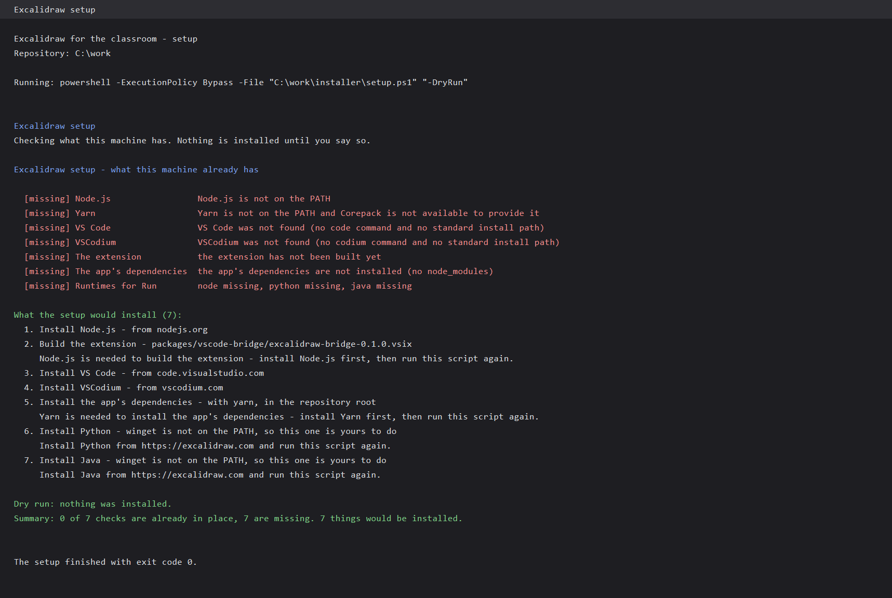
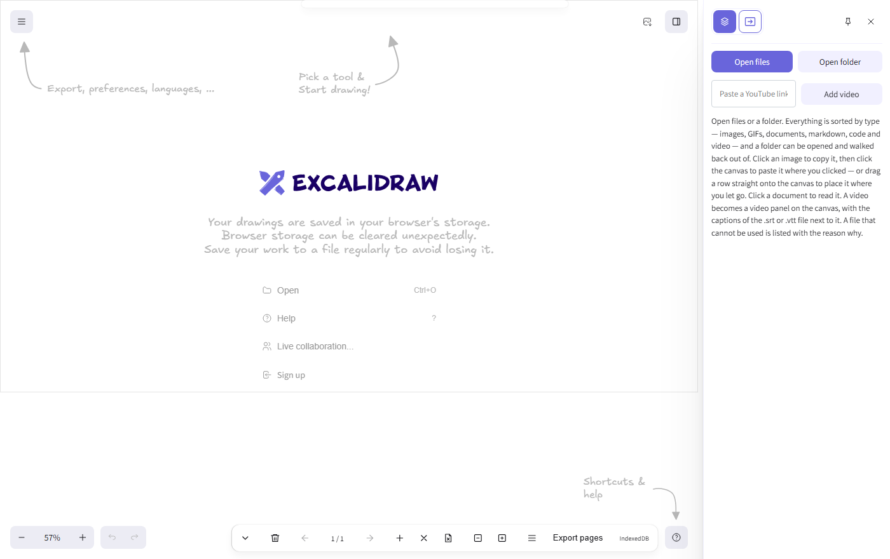

# Installing it

Three ways in, from most automatic to most manual. Pick one.

| you want | do this |
| --- | --- |
| **a working classroom in one step** | [The setup](#1-the-setup) — it checks what is missing and installs it |
| **nothing installed on the machine at all** | [The container](#2-the-container) — one `docker pull` and one `docker run` |
| **to read the code** | [From source](#3-from-source) |

Whichever way you came in, the **VS Code / VSCodium extension** is what connects your editor to the canvas. The setup installs it for you; the other two routes need one command.

---

## 1. The setup

The setup is the whole point of this project: a person with a laptop, an editor and a class to teach should not have to work out that they need Node, that Yarn comes from Corepack, and that the extension is installed from a `.vsix`.

**Windows** — download `setup.exe` from the [releases page](https://github.com/Sairampv98/excalidraw-classroom/releases) and put it in the root of the project. Double-click it, or run it from a terminal:

```powershell
.\setup.exe
```

**macOS and Linux** — use `installer/setup.sh` from the project:

```bash
bash installer/setup.sh
```

### What it does

It **reports** what it finds, **asks** before it installs anything on your machine, and ends with a summary.



Three switches:

| switch    | what it does                                                   |
| --------- | -------------------------------------------------------------- |
| _(none)_  | reports, then **asks** before each install                     |
| `-Yes`    | accepts the defaults and installs without asking               |
| `-DryRun` | reports and installs **nothing** at all — safe to run anywhere |

It is **safe to run twice**: everything it checks is idempotent, and a second run says _already there_ rather than doing it again.

### What it installs

- **Node.js** 20 or newer — from winget or Homebrew when they are there, and **from nodejs.org itself** when they are not. Node brings Corepack, which brings Yarn.
- **VS Code** and **VSCodium** — the same rule: the package manager when there is one, the official installer when there is not. You need one of them for the bridge.
- **The extension** — built from the project if it is not built, then installed into whichever editor it found.
- **The app's dependencies** — `yarn install`, in the project root.
- **Python** and **Java** — only if they are missing, and only for the panel's **Run** button. They are optional.

The setup re-reads the machine after installing Node, so the things that needed Node — Corepack, the extension's build, the app's dependencies — are done in **the same run**. You do not have to come back.

### Nothing is installed silently

Without `-Yes` the setup asks, one question per thing, and the answers default to _no_. If you answer no, it moves on and tells you what is left to do.

---

## 2. The container

If the machine cannot have anything installed on it — a locked-down lab, a student's laptop, a server — the app runs in a container instead.

```bash
docker pull lolking69/excalidraw-classroom:0.1.0
docker run -d --name excalidraw -p 3000:80 lolking69/excalidraw-classroom:0.1.0
```

Then open <http://127.0.0.1:3000>.



> Use `127.0.0.1`, not `localhost`. On Windows, `localhost` resolves to `::1` first, and the container's port is published on IPv4.

Stop it again with `docker stop excalidraw`.

### The extension still runs on the host

The extension lives **inside** your editor, so it cannot live in a container. The container reaches the editor's bridge over **`host.docker.internal`** — the name Docker gives the host machine — and that is baked into the app when the image is built:

```
VITE_APP_BRIDGE_URL=ws://host.docker.internal:47511
```

So on the host you still need the extension installed (the [setup](#1-the-setup) does it), and the container talks to it.

If your extension is on another port, build the image with the matching URL:

```bash
docker build \
  --build-arg VITE_APP_BRIDGE_URL=ws://host.docker.internal:47611 \
  -t my-excalidraw:0.1.0 .
```

### From the compose file

```bash
docker compose -f docker/docker-compose.yml up --build -d
```

---

## 3. From source

```bash
git clone https://github.com/Sairampv98/excalidraw-classroom.git
cd excalidraw-classroom
yarn install
yarn start
```

The development server is on <http://localhost:3001>.

To build the extension as well:

```bash
node packages/vscode-bridge/scripts/build-setup-exe.mjs
```

---

## The extension

The extension is the **bridge**: it is what connects the editor to the canvas.

```bash
code    --install-extension packages/vscode-bridge/excalidraw-bridge-0.1.0.vsix --force
codium  --install-extension packages/vscode-bridge/excalidraw-bridge-0.1.0.vsix --force
```

It works in **VS Code** and in **VSCodium** — the same file, both editors.

### The token

The bridge listens on the **loopback interface only**, on a **fixed port** (`47511`), and asks for a **per-session token** the first time it starts.

1. Click the extension's **status bar item** and choose **"Copy token"**.
2. In the canvas, select a panel, open its **properties**, paste the token into the **Bridge** box and press **Connect**.

That is **once per tab**. The token is remembered for the tab's session, so a reload does not ask for it again.

The token is a secret and is treated like one:

- it is negotiated **in band**, in the first WebSocket frame — never in a URL;
- it is held **in memory** for the session only — never written to the document, never to local storage;
- the captured frames **never reach your drawing**.

---

## On a machine on ARM64

Everything here works on **Windows on ARM** — but two things differ, and it is better to say so than to let you find out.

**What is the same.** The extension is plain JavaScript, the capture and the virtual-display helpers call **Windows' own APIs** (`user32.dll`) and nothing else, and the OCR engine is **WebAssembly**. There is no x64 binary anywhere in the package.

**What differs.**

1. **The Python path.** The extension ships a default path to a Python that was installed on the machine that built the package, and that path is an **x64** Python. On an ARM64 machine it is not there. Change it in the settings:

   ```json
   "excalidraw-bridge.pythonPath": "C:\\path\\to\\your\\python.exe"
   ```

   You only need Python for the **Paddle** OCR engine. **Tesseract** works with no Python at all, because it is WebAssembly.

2. **The setup picks the right installer.** It asks the machine what it is (`x64` or `arm64`) and downloads the matching Node.js, VS Code and VSCodium. You do not have to do that by hand.

**The container** is a Linux image, so it runs the same on an ARM64 machine as on an x64 one — through Docker's own emulation if it has to.

---

## If something does not work

| what you see | what it means |
| --- | --- |
| the panel says _"not connected to the Excalidraw Bridge"_ | the extension is not running, or the token was not pasted. Reload the editor window and copy the token again. |
| the editor says the port is taken | another editor holds `47511`. Close it, or give this one a different port (`excalidraw-bridge.port`) and point the app at it (`VITE_APP_BRIDGE_URL`). |
| the app is blank | the dev server is not running: `yarn start`. |
| OCR says the sidecar is not running | the Python engine is not installed or the path is wrong. **Tesseract** needs no Python — pick it in the panel's engine picker. |
| the live view is black | the extension could not find the editor's window. Make sure the editor is running and the panel is on the **Live window** view. |

---

## The clips

Every feature has a short recording in [`../clips/`](../clips/index.html).
