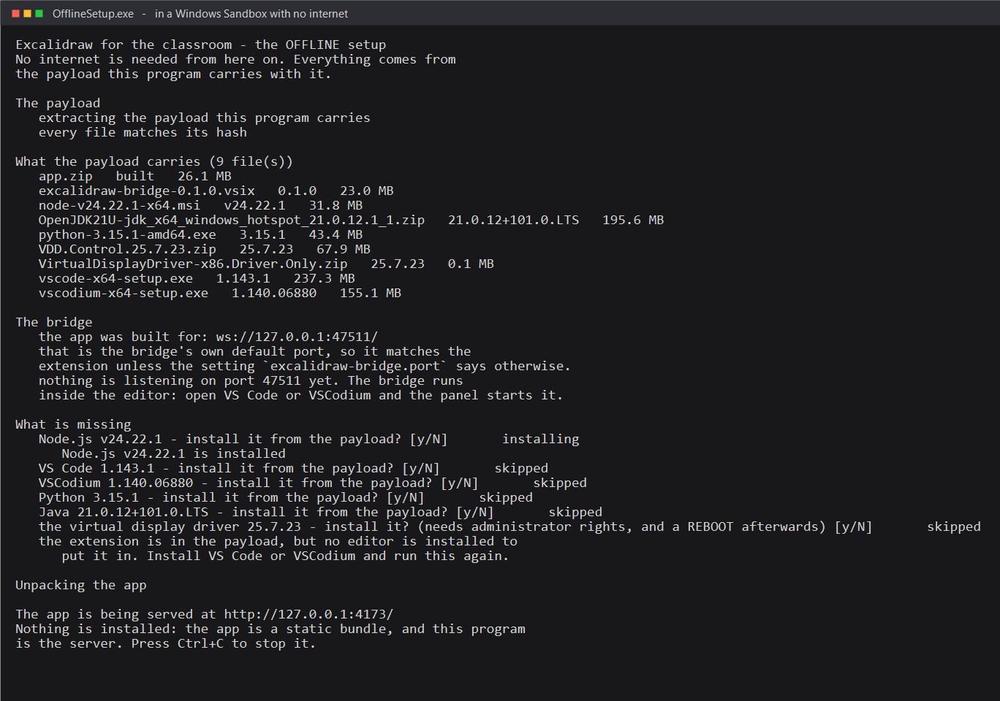

# The offline setup

The [setup](INSTALL.md#1-the-setup) **downloads** what it installs. A classroom machine does not always have an internet connection: a locked-down lab, a school network that blocks everything, a laptop on a train between two stops.

This is the setup for those machines. It is **one file**, it **carries everything it needs with it**, and it installs from that copy. There is no download step, no `yarn install`, and no package manager to find first.

And it does one more thing, which is the reason it exists: it can **run the whiteboard with nothing installed at all** — no Node, no Python, no editor. Just the app.

---

## Using it

Copy the file onto the machine and run it:

```powershell
.\OfflineSetup.exe
```

It reports what it carries, **asks** before it installs anything, installs what you agree to, and then opens the whiteboard in your browser.

| switch | what it does |
| --- | --- |
| _(none)_ | reports, then **asks** before each install |
| `-Yes` | accepts the answers and installs without asking |
| `-DryRun` | reports and installs **nothing** at all — safe to run anywhere |
| `-NoServe` | installs, but does not start the app's web server |
| `-NoBrowser` | serves the app, but does not open a browser |
| `-Port <n>` | serves the app on another port (it is `4173` by default) |
| `-PayloadRoot <dir>` | unpacks the payload somewhere else — a USB stick, or a second drive |



**Nothing is installed silently.** Without `-Yes` the setup asks, one question per thing, and a question that cannot be answered counts as _no_.

---

## What it carries

The payload is about **780 MB** and it holds nine things:

| what | why |
| --- | --- |
| the **built app** (`app.zip`) | the whiteboard itself — a **static bundle**, so it needs no server and no packages |
| the **extension** (`.vsix`) | the bridge between the editor and the canvas |
| the **Node.js** MSI | the panel's **Run** button, for the teacher's own code |
| the **VS Code** installer | the editor the bridge lives in |
| the **VSCodium** installer | the same bridge, in the open-source editor |
| the **Python** installer | only for the optional `indra` and `paddle` OCR engines |
| the **Java** archive | only for the **Run** button on `.java` files |
| the **display driver** | a second screen, for the projector |
| **VDD Control** | the app a teacher uses to put that second screen into **Extend** |

Two of those are worth spelling out, because they are what make the offline setup possible at all:

**The app's npm dependencies are not in the payload, and do not need to be.** The app is a **static bundle** — HTML, JavaScript and images, served as they are. It needs no server runtime and no `node_modules`, so the offline setup never installs any npm packages.

**Python is not in the payload either, and does not need to be.** The default OCR engine, **Tesseract**, is **WebAssembly inside the extension** and runs in the extension's own process. Python is only for the optional `indra` and `paddle` engines.

---

## What it installs

Everything comes out of the payload, so every install below works with **no internet**:

| what | how it is installed |
| --- | --- |
| **Node.js** | `msiexec /i <the MSI> /qn /norestart` |
| **VS Code** | its own installer, `/VERYSILENT /NORESTART /SP-` |
| **VSCodium** | its own installer, the same way — the **per-user** one, so no password is needed |
| **Python** | its own installer, `/quiet InstallAllUsers=0 PrependPath=1 Include_pip=1` |
| **Java** | the Temurin archive is **unpacked**, and its `bin` is added to the machine's `PATH` |
| **the display driver** | the driver's own installer, through `pnputil` |
| **the extension** | `code --install-extension` / `codium --install-extension` |

The two steps that change the **whole machine** — the display driver and Java's `PATH` — need **administrator rights**, so the setup **relaunches itself** with Windows' `runas` verb and you get the usual password prompt.

---

## The second screen, and the reboot

The **virtual display driver** is the one step that cannot be finished in the moment. It needs **administrator rights**, and the machine needs a **reboot** before the second screen exists.

The setup says both, plainly:

> the driver was installed. IT NEEDS A REBOOT before there is a second screen. Until the machine has been restarted, the display does NOT work — and the extension will say so, because there is no virtual display yet.

After the reboot, open **VDD Control** (it is in the payload, and the setup unpacks it) and set the monitor to **Extend**. The extension then finds the virtual screen and the live view can be projected.

---

## Running the app with nothing installed

This is the part that needs no permission and no password at all.

The offline setup **is** the server: it serves the prebuilt app out of the payload on `http://127.0.0.1:4173/` and opens your browser on it. There is nothing to install, nothing to configure and nothing to start — the whiteboard is simply there.

The **bridge** still needs the editor, because the extension lives inside it. The app prints the bridge URL it was built with:

```
The bridge
   the app was built for: ws://127.0.0.1:47511/
   that is the bridge's own default port, so it matches the
   extension unless the setting `excalidraw-bridge.port` says otherwise.
   nothing is listening on port 47511 yet. The bridge runs
   inside the editor: open VS Code or VSCodium and the panel starts it.
```

That URL is **baked into the app when it is built** (`VITE_APP_BRIDGE_URL`), so it cannot be changed afterwards. If it is not the port your bridge runs on, the setup says so rather than pretending:

> that is NOT the bridge's default port (47511). The extension listens on 47511 unless its setting `excalidraw-bridge.port` says otherwise, so the panel will NOT connect unless the two are made to agree.

---

## On a machine on ARM64

The offline setup is built for one architecture at a time, and the builder is told which:

```bash
node installer/offline/build-payload.mjs --arch arm64
```

Everything in the payload has an ARM64 version, and the executable itself is built **AnyCPU**, so the same file runs on x64 and on ARM64 Windows.

Two things still differ, and it is better to say so than to let you find out:

1. **The Python path.** The extension ships a default path to the Python that was on the machine that built it, and that path is an **x64** Python. On an ARM64 machine it is not there. Change it in the settings:

   ```json
   "excalidraw-bridge.pythonPath": "C:\\path\\to\\your\\python.exe"
   ```

   You only need Python for the **Paddle** OCR engine. **Tesseract** needs no Python at all.

2. **The display driver.** The ARM64 build carries `VirtualDisplayDriver-ARM64.Driver.Only.zip` — the ARM64 driver — rather than the x86 one. The `VDD Control` app is the same for both.

---

## Building it

The payload is **build output** and is not in the repository. Build it once, on a machine with an internet connection:

```bash
node installer/offline/build-payload.mjs --arch x64
```

It downloads the installers, builds the extension, zips the app, and writes `manifest.json` — the hash and the version of every file. It is **re-runnable**: a file that is already in the payload is not downloaded again.

Then compile the executable that carries it:

```bash
node installer/offline/build-offline-setup.mjs
```

The compiler is the one that **ships with Windows** (`csc.exe` in the .NET Framework folder), so the project gains no dependency of its own, and the program is **C# 5** — the newest that compiler understands.

### The payload is checked before anything is installed

On the first run the payload is unpacked to

```
%LOCALAPPDATA%\ExcalidrawClassroom\payload
```

and **every file is checked against the SHA-256 in `manifest.json`**. A payload that does not match is **refused**: nothing is installed and nothing is served. The offline setup has **no download code in it at all** — a file that is missing from the payload is **reported**, never fetched.

The payload is carried **in pieces** — the executable's resources, a few megabytes each — and the pieces are written **straight** into the payload folder, one at a time, with each file's hash checked as it is written. That is why the disk holds the payload **once**, and never a copy of it: the payload is big, and a machine with a small disk (a classroom laptop, a Sandbox) cannot hold it twice.

---

## The proof

`installer/offline/offline.wsb` is a **Windows Sandbox with no networking** (`<Networking>None</Networking>`). It runs the setup inside, and writes what happened into the host's folder:

```powershell
Start-Process 'C:\Windows\System32\WindowsSandbox.exe' -ArgumentList '"C:\Users\user\projects\offline-test\offline.wsb"'
```

The proof is three things:

1. the setup runs with **no network** and still finds its payload;
2. it **serves the app**, and a request for the app's HTML comes back **200**;
3. it **installs what it can**, from the payload, and says so.

### The network is taken down from inside as well

On the machine this was proved on, `<Networking>None</Networking>` **did not take the internet away**: the Sandbox came up with its adapter **up** and a default route, and a request to the internet was **answered**. So `run.ps1` does not trust the setting. It **takes the network down from inside** — an outbound firewall rule where the Sandbox has one, and the adapter that has the default route is disabled — and then **probes the machine three ways**: a DNS lookup, a raw TCP connection to a public address, and an HTTP request. If any of them answers, the run says the proof is **not valid**.

And it probes **before** it takes the network down, so the record says what the Sandbox really did.

### What cannot be proved in a Sandbox

**The display driver.** It needs a reboot and a real display, and neither exists inside a Sandbox. The setup's behaviour there — asking, elevating, and saying that a reboot is needed — is the part that is shown.

**One thing to watch: the disk.** The Sandbox's disk is a file on the host's drive, and it grows with everything written inside it — the payload, the unpacked app, and the installs. The full payload is 780 MB, and unpacking it inside a Sandbox needs more room than a laptop with a nearly full C: drive has to spare. Put the mapped folder on a drive with room, and watch the free space while the Sandbox runs.
